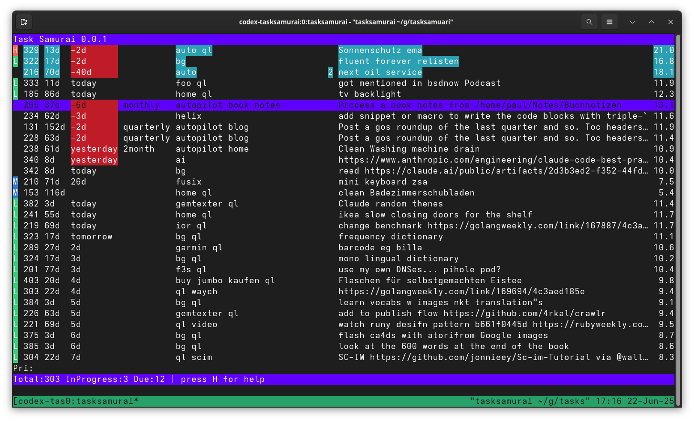

# Task Samurai


Task Samurai is a fast terminal interface for [Taskwarrior](https://taskwarrior.org/) written in Go using the [Bubble Tea](https://github.com/charmbracelet/bubbletea) framework. It shows your tasks in a table and lets you manage them without leaving your keyboard.

## Why does this exist?

- I wanted to tinker with agentic coding (actually, it has been mainly been generated by LLMs. 
- I wanted a faster UI for Taskwarrior than other options like vit which is Python based.
- I wanted something built with Bubble Tea but never had time to deep dive into it.

## How it works

Task Samurai invokes the `task` command to read and modify tasks. The tasks are displayed in a Bubble Tea table where each row represents a task. Hotkeys trigger Taskwarrior commands such as starting, completing or annotating tasks. Taskwarrior changes refresh its rows automatically. An optional Jira Cloud source merges issues into the same table, with separate asynchronous requests and an in-memory cache.

## Hotkeys

Press `H` to view all available hotkeys.

Press `4` to toggle the `+agent` / `-agent` filter, `5` to toggle
`+auto` / `-auto`, and `3` to toggle `+track` / `-track`, in table or ultra
mode. With neither sign present, the first
press adds the positive filter. Each later press switches between including
and excluding that tag, preserving other filters. These filters apply to
Taskwarrior rows; `F` selects the Jira query.

Press `6` in table or ultra mode to cycle source views: Taskwarrior only (`tw`) →
both → Jira only (`jira`). This uses cached rows; Jira must be enabled.

The number-key actions are configurable with the flags below. Any digit
`0`–`9` can be assigned; `7`–`9` are unassigned by default. For example,
`tasksamurai --agent-hotkey 7 --auto-hotkey 8` moves the tag toggles to `7` and
`8`. To swap two actions, use `--agent-hotkey 5 --auto-hotkey 4`. Help reflects
your assignments. Keys that conflict with other commands or each other are
rejected, and the default assignments are used.

Example: press `+`, type `Buy milk` and hit Enter to add a new task called "Buy milk".

Press `R` to edit the selected task's recurrence. On a recurring task, press
`Ctrl+R` to edit the recurrence across the known recurring series.

Press `:` in either table or ultra mode to open a Taskwarrior command prompt.
The prompt supplies `task`; type arguments such as `add Buy milk`, `projects`,
or `+home list`. Press `;` to open the same prompt pre-filled with the selected
task UUID, ready for commands like `modify`, `annotate`, or `done`. Press `Tab`
for completion, `Enter` to run, and `Esc` to cancel. Press `Ctrl+O` while in
the prompt to pop the current command line out into `$EDITOR`; when you save and
quit, the edited text is loaded back into the prompt so you can review it and press
`Enter` to run. Commands that print output
open a scrollable output panel.

Task Samurai has several toggle keys. Press `v` to switch between the full
table and a compact view (Pri, Project, Description, Urg). Press `Z` to cycle
auto-refresh through off → 10s → 60s → 5m → 15m → off; while enabled the task
list reloads in the background as if you pressed `space` at the chosen
interval, and a persistent `auto-refresh: on (10s)` indicator appears in the
status line (works in compact and ultra mode too, and reloads pause while you
are typing). Press `B` to toggle the row blink animation after task
modifications, and press `x` to toggle disco mode, which picks a random theme
on every task change. Press `V` to cycle the completed-task display window
through off → 1 day → 4h → 1h → off: each setting additionally shows tasks
completed within that timeframe before now, dimmed grey with a struck-through
description, sorted to the bottom of the list. Completed Taskwarrior rows
show `✓`; completed Jira rows keep their issue key.
The current window shows up in the top status line as `completed: on (1d)`.
All of these are also listed on the in-app help screen
(`H`).

## Scrolling

Every screen scrolls. The task table pages with `pgup`/`pgdn` (or `b`), and
half pages with `Ctrl+U`/`Ctrl+D`. The help screen, the `:` command output
panel, and the task detail view scroll with `j`/`k` or arrow keys, page with
`pgup`/`pgdn` (or `b`/`space`), and half-page with `Ctrl+U`/`Ctrl+D`; `g`/`Home`
and `G`/`End` jump to the top or bottom. In the detail view, `↑`/`↓` move the
field highlight and the view scrolls to keep it visible; `/` searches the
detail view and `n`/`N` jump between matches. In table and ultra mode `space`
refreshes the task list instead of paging. All long content stays reachable —
nothing is cut off at the bottom of the screen.

When Jira is enabled, press `F` in table or ultra mode to choose a named Jira
filter from local configuration or the account's saved cloud filters. Type to
fuzzy-search names and JQL; use the arrow keys or Ctrl+n/Ctrl+p
to navigate, `Enter` to apply, and `Esc` to cancel. Clearing the query restores
the full list. Printable `j`, `k`, and `r` enter search text; `Ctrl+r`
refreshes saved cloud filters. Cloud entries have an origin marker, so duplicate
names remain distinguishable.
`(none) all issues` removes the JQL restriction; some sites require a restricted
filter. This selection lasts for the session and refreshes Jira issues only.

## Screenshot



## Installation

There are two ways to install the `tasksamurai` command:

```bash
go install github.com/snonux/tasksamurai/cmd/tasksamurai@latest
```

Alternatively, clone this repository and run:

```bash
mage install
```

The second method requires [mage](https://magefile.org/) to be installed.

### Usage

```bash
# Start with default pending tasks
tasksamurai

# Start with a Taskwarrior filter
tasksamurai +tag status:pending
tasksamurai project:work due:today
tasksamurai pri:H
tasksamurai -- -excludetag
tasksamurai -- -excludetag +includetag

# Any valid Taskwarrior filter can be passed as arguments
```

### Flags

- `--version`: print the Task Samurai version and exit
- `--config <path>`: select a TOML config file (overrides `TASKSAMURAI_CONFIG`)
- `--no-jira`: disable Jira semantic validation, credential loading and requests
- `--ultra`: start in ultra mode
- `--browser-cmd <command>`: command used to open URLs (default: firefox on Linux, open on macOS)
- `--youtube-browser-cmd <command>`: command used to open `youtube.com` / `youtu.be` links with the `o` key (default: `chromium`, so YouTube videos play in a browser better suited for them than the general `--browser-cmd` default). Set it to `""` to route YouTube links through `--browser-cmd` like any other URL.
- `--first-hotkey <key>`: jump to the first task (default: `0`)
- `--random-hotkey <key>`: jump to a random pending task in table mode (default: `1`)
- `--random-no-due-hotkey <key>`: jump to a random pending task without a due date in table mode (default: `2`)
- `--agent-hotkey <key>`: toggle the `+agent` / `-agent` filter (default: `4`)
- `--auto-hotkey <key>`: toggle the `+auto` / `-auto` filter (default: `5`)
- `--jira-hotkey <key>`: cycle `tw` / `both` / `jira` source views (default: `6`)
- `--track-hotkey <key>`: toggle the `+track` / `-track` filter (default: `3`)
- `--debug-log <path>`: path to debug log file for Taskwarrior commands
- `--debug-dir <directory>`: directory for runtime debug output (goroutine dumps, profiles)
- `--disco`: start Task Samurai in disco mode, changing the theme every time a task is modified

Hotkeys accept a single character, `tab`, `shift+tab`, or `ctrl+<letter>`;
reserved command keys cannot be reassigned. An empty value uses the default.

## Jira Cloud

Taskwarrior remains required. Jira is optional and disabled when the default
config file or its `[jira]` section is absent. Create
`~/.config/tasksamurai/config.toml` to enable it:

```toml
[jira]
site = "https://example.atlassian.net"
email = "your-atlassian-account@example.com"
token_file = "~/.jira_api_token"
enabled = true
saved_filters = true
default_filter = "tests"
default_view = "both" # tw, both, or jira
max_results = 100
timeout = "10s"

[[jira.filters]]
name = "tests"
jql = "project in (TST, TST2) ORDER BY updated DESC"

[[jira.filters]]
name = "mine"
jql = "project in (TST, TST2) AND assignee = currentUser() ORDER BY updated DESC"
```

Replace the site, account email and project keys for your Jira account. Store
the complete API token in the referenced file and restrict its permissions
(`chmod 600 ~/.jira_api_token`); the token is never an inline config setting.
Only surrounding whitespace is trimmed. Relative token-file paths resolve
against the config directory, and `~/` expands to your home directory.

Config-path precedence is explicit `--config`, then non-empty
`TASKSAMURAI_CONFIG`, then the default path. An explicitly selected missing file
is an error. Filter names must be unique, JQL must be non-empty, and
`default_filter` must name a local filter; omitting it selects `(none)`. `enabled = false` or `--no-jira`
skips Jira semantic validation and token reads; TOML syntax, field-type and
unknown-setting errors still fail startup. Configuration changes require a
restart. An explicit `space` refresh rereads the token file for token rotation.

Jira rows show keys such as `TST-42` and `TST2-42` in the ID column. The list
uses the Project column for workflow status and Recur for assignee, with headers
`Project / Status` and `Recur / Assignee` in mixed view (`Status` and `Assignee`
in Jira-only view). Unassigned issues show `Unassigned`. The synthetic `jira`
tag is hidden; real Jira labels remain visible. Project metadata and the source tag remain available internally
for filtering. Existing real labels named `jira` are retained separately.

### Jira controls

The table below describes Jira controls in table and ultra mode, with exceptions
noted per key. Detail views also support comments, opening, transitions and field
edits.

| Key | Jira behavior |
| --- | --- |
| `6` | Cycle cached source views: `tw` → `both` → `jira` → `tw` (`--jira-hotkey` changes the key) |
| `F` | Pick a local or cloud saved filter with fuzzy search; arrows/Ctrl+n/Ctrl+p navigate, Enter applies, Esc cancels, Ctrl+r refreshes cloud filters |
| `a` | Add a comment; blank comments are refused |
| Ctrl+w | Log work with a duration and optional note; Enter submits, Esc cancels |
| `o` | Open the issue in the configured browser, ahead of description URLs or file references |
| `d` | Transition to an available done-category status |
| `s` | Start/stop through available in-progress/todo category transitions |
| `w` / `W` | Set/clear the date-only due date |
| `r` | Set a random future due date |
| `p` | Choose H/M/L, written as Jira priority names High/Medium/Low |
| `t` | Edit labels with `+label` / `-label`; synthetic `jira` is never added as a real label |
| `e` / `E` | Edit the issue summary inline |
| `Enter` | Open fresh issue details from table/ultra; edit the highlighted editable field inside details |
| `i` | Edit the selected table cell or detail field |
| `space` / `Z` | Explicit refresh / periodic refresh of both sources and saved filters (table/ultra) |
| `V` | Include recently completed issues using the same completed window as Taskwarrior |

`A`, `D`, `U`, `R`/Ctrl+r, `J`, `T`, and the selected-task `;` prompt are blocked
on Jira rows, with a reason in the status bar. The global `:` prompt and `+`
always operate on Taskwarrior, including in Jira-only mode. The picker handles
Ctrl+r as cloud refresh while it is open; outside it Ctrl+r remains the
Taskwarrior recurrence action and is blocked on Jira rows.

Transitions are selected from the issue's current available workflow by status
category, independently of custom status names. Ambiguous choices use a
stable name/ID order and report the chosen transition. Optional exact-name
overrides and native JSON-shaped screen defaults can resolve workflow choices:

```toml
[jira.transitions]
done = "Close Issue"
# start = "Begin Work"
# stop = "Return to Backlog"

[jira.transition_fields]
resolution = { name = "Done" }
```

Use names and fields valid for your workflow. Missing required screen fields
are reported without posting a transition. Writes are never automatically
retried. After a confirmed field/transition write, one issue GET patches the
cache; a failed follow-up read is reported separately from a failed write.

### Jira time tracking

Press **Ctrl+w** on a Jira issue in table, ultra or detail view. Enter a duration
using hours, minutes or seconds, optionally followed by a semicolon and note:

```text
1h 30m; Implemented the API client
45m
```

Enter logs the work; Esc cancels. Durations must be positive whole seconds
(`1.5h` is accepted; days/weeks and bare numbers are not). The start time is
calculated as the current time minus the entered duration. Notes are saved as
ADF worklog comments. The remaining estimate stays unchanged.

Normal Jira view shows **Logged** in place of the unused annotation count
(mixed-view header: **Ann / Logged**). Select that cell and press `i` to log
more work. Ultra view shows `logged: 1h 30m`, and issue details show **Time spent**.
These values are the issue’s total logged work reported by Jira, across all
authors, and refresh after a successful submission or an explicit refresh.
Your Jira site must have time tracking enabled and your account needs the
Work on issues permission. Worklog writes are never automatically retried.
If a response is ambiguous or the follow-up refresh fails, check Jira before
submitting again. `s` continues to change workflow status; it does not start a
timer or log work automatically.

### Refresh and details

Taskwarrior rows appear before Jira's first network fetch completes. Jira
issues refetch at startup, explicit `space`, the configured `Z` interval, and
filter changes. View cycling, picker reopening and ordinary navigation reuse
cached rows. Saved filters load on first picker open or refresh, and keep their
last-good list if a refresh fails. Changing a Jira filter clears the previous
filter's issue rows immediately; a failed same-filter refresh keeps its cache.

The status token shows source mode, selected Jira filter and the last successful
issue-list fetch time, for example `[both · jira: tests · 14:32]`. Cloud selections
show `(cloud)`; hitting `max_results` adds a limit indicator. Errors leave
Taskwarrior rows available. Reads retry once on throttling/server errors within
the request timeout.

Opening Jira details fetches fresh fields and the first page of comments,
updates the cached issue and displays the assignee, issue URL and a `+n more`
hint when comments are truncated. Jira rows show logged time instead of comment counts in the list.
Comments appear after server confirmation. There is no disk cache.

## Development and Jira integration tests

`mage build` builds the binary. `mage test` runs ordinary tests, and
`mage verify` checks formatting and ignored errors before those tests. These
commands do not enable Jira integration tests or contact the live site.

The Jira tests have three layers: unit/fixture tests, `httptest` API tests and a
build-tagged live suite. The live suite needs two distinct dedicated projects and permission to create
issues, log work, edit fields and perform the tested workflow transitions:

```bash
export JIRA_TEST_SITE=https://snonux.atlassian.net
export JIRA_TEST_EMAIL=your-atlassian-account@example.com
export JIRA_TEST_TOKEN_FILE=~/.jira_api_token
export JIRA_TEST_PROJECT=TST
export JIRA_TEST_SECOND_PROJECT=TST2

mage jiracheck # read-only auth, project and issue-type checks
JIRA_INTEGRATION=1 JIRA_TEST_UNBOUNDED=1 mage jiratest
```

`JIRA_TEST_UNBOUNDED=1` enables the optional site-specific 400 probe; omit it
for a site that permits unrestricted search. `JIRA_TEST_ISSUE_TYPE_ID` can
select a creatable non-subtask issue type; otherwise the suite discovers one.
The API test suite still skips live tests without `JIRA_INTEGRATION=1`, even
when compiled with `-tags integration`.

The lifecycle test creates four issues across the two projects; the worklog
test creates one additional issue per project. Every fixture has an exact
`ts-integration-<run-id>` summary marker. Every mutation and cleanup rechecks ownership
against a fresh issue GET. Queries are bounded to the configured projects and
run marker. Cleanup deletes only those fixtures; if deletion is forbidden, it
tries to mark them done and reports the limitation. It does not sweep other
runs. This leaves resolved, marked fixtures on accounts without delete
permission; `V` can display recent completed fixtures for manual TUI checks.

On 2026-10-30, both projects were created through the API with user authorization.
The full live suite passed against them, including different project/issue-key
mapping, real pagination, comments, transitions and field edits. Delete returned
403, so the eight fixtures from those two runs remain marked and done. A later
focused worklog run also passed in both projects; its two marked fixtures remain
resolved with 60 seconds logged each.
TUI rendering of distinct `TST`/`TST2` keys is also covered by hermetic UI tests.
See [the design and verification record](docs/jira-support.md) for details.

## Debugging

If Task Samurai hangs, freezes, or stops responding to hotkeys (e.g. `d`
does nothing), build with `-tags debugsignals` and send `SIGUSR1`/`SIGUSR2`
to the running process to capture goroutine stacks, a snapshot of the UI's
own state, and full profiling data. See [docs/debugging.md](docs/debugging.md)
for the full guide, including why hotkeys can silently stop working and how
to read each dump.
